# Learner Guide — ISO 14001:2015 Internal Auditor Training

**TGS Ref No:** TGS-2025054479  ·  **Version:** 5.0  ·  **17 August 2026**

Tertiary Infotech Academy Pte Ltd (UEN: 201200696W)

## 1. About This Course

This 16-hour course prepares you to plan, conduct, report and follow up an **internal audit of an Environmental Management System (EMS)** based on **ISO 14001:2015**, using the **International Professional Practices Framework (IPPF)** and the auditing guidance of **ISO 19011:2018**.

It runs over **2 days** — 14 hours of facilitation plus 2 hours of assessment — and is aligned to the Skills Framework TSC **Internal Audit Engagement Planning (ACC-IAD-3005-1.1, Level 1)**.

### 1.1 Learning Outcomes

- **LO1:** Identify ISO 14001:2015 standards for internal auditing based on the International Professional Practices Framework (IPPF) and organisational risks
- **LO2:** Identify phases of engagement with stakeholders by applying ISO 14001:2015 internal audit methodologies and procedures
- **LO3:** Support preliminary risk assessments using risk identification and assessment techniques

### 1.2 What Is Assessed

| Code | Statement | Assessed by |
|---|---|---|
| K1 | International Professional Practices Framework (IPPF) comprising definitions of Internal Auditing, Code of Ethics, core principles and International Standards for the Professional Practice of Internal Auditing | Written Assessment (SAQ) |
| K2 | Organisation's significant risks, objectives, resources, operations, businesses and structure | Written Assessment (SAQ) |
| K3 | Internal audit methodologies and procedures of the organisation | Written Assessment (SAQ) |
| K4 | Risk identification and assessment techniques | Written Assessment (SAQ) |
| A1 | Identify relevant frameworks, guidelines and standards to be applied in the engagement | Case Study (CS) |
| A2 | Identify stages of the engagement and various stakeholders involved | Case Study (CS) |
| A3 | Support conduct of preliminary survey and risk assessment | Case Study (CS) |

### 1.3 How to Use This Guide

Work through Topics 1–3 alongside the slides. Every activity in Section 5 gives you the full scenario, the step-by-step method, the questions to answer, and a self-check. **Both assessments are open book** — this guide is your primary reference, so annotate it freely during the course.

> **IMPORTANT —** ISO 14001:2015 was withdrawn on 15 April 2026 and replaced by ISO 14001:2026, with a 36-month transition for existing certificates. This course teaches the **2015 edition** because that is the edition most auditees are currently certified to, and it is the edition named in this course's approved scope. The 10-clause high level structure is retained in the 2026 edition.

## 2. Topic 1 — ISO 14001:2015 Internal Auditor Framework

**LU1: Introduction to ISO 14001:2015**  ·  **LO1**  ·  Knowledge/Ability: **K1 · K2 · A1**

### 2.1 The International Professional Practices Framework (IPPF)  [K1]

The IPPF is the professional framework that governs how internal auditors behave and work. Four components are **mandatory**:

| Component | What it says | What it means for you |
|---|---|---|
| Definition of Internal Auditing | An independent, objective assurance and consulting activity designed to add value and improve an organisation's operations. | You are not an inspector and not a policeman — you add value by improving risk management, control and governance. |
| Code of Ethics | Integrity · Objectivity · Confidentiality · Competency. | You must not audit your own work, must not disclose what you learn, and must decline (or get support for) work beyond your competence. |
| Core Principles | Demonstrates integrity, competence and due professional care; is objective and free from undue influence; aligns with strategy; is insightful, proactive and future-focused. | Your audit plan should follow organisational risk, not organisational convenience. |
| International Standards | Attribute standards (who we are) and performance standards (what we do). | Engagements must be planned, evidenced, documented and reported. |

#### The Code of Ethics in practice

- **Integrity** — Perform work with honesty, diligence and responsibility. Do not knowingly be party to any illegal activity.
- **Objectivity** — Maintain an unbiased mental attitude and avoid conflicts of interest. Do NOT audit an area for which you have operational responsibility.
- **Confidentiality** — Respect the value and ownership of information received; do not use it for personal gain.
- **Competency** — Apply the knowledge, skills and experience required. If a process is beyond you technically, bring in a specialist.

> **AUDIT TIP —** Record your independence in the audit plan BEFORE fieldwork starts. A single line — 'the auditor has no operational responsibility for the areas audited' — protects the whole engagement.

### 2.2 ISO 14001:2015 and the EMS  [K1]

ISO 14001:2015 specifies the requirements for an environmental management system that an organisation can use to enhance its environmental performance. The standard's **three intended outcomes** are:

1. **Enhancement of environmental performance** — the EMS must actually improve performance, not merely document what already happens.
2. **Fulfilment of compliance obligations** — legal requirements the organisation has to comply with, and other requirements it has to or chooses to comply with.
3. **Achievement of environmental objectives** — objectives consistent with the environmental policy and the significant environmental aspects.
Two rules that catch new auditors out:

- **There is no clause-exclusion mechanism.** Unlike ISO 9001, claims of conformity are not acceptable unless ALL requirements are incorporated and fulfilled.
- **The standard sets no environmental performance levels.** It requires the organisation to set its own criteria and indicators (clause 9.1.1).

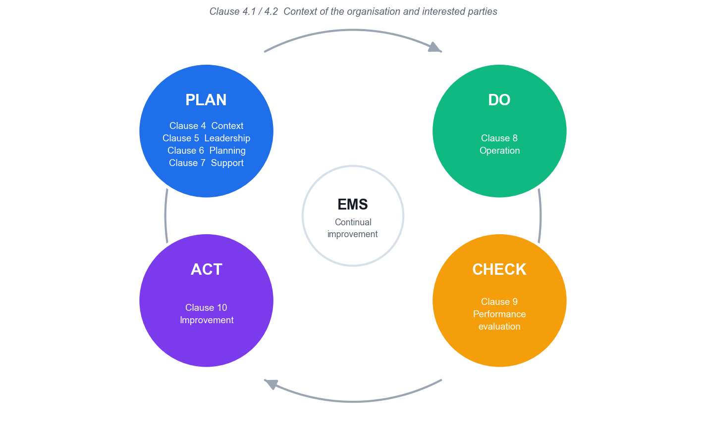

*PDCA mapped to the clauses. Context (4.1/4.2) encircles the cycle.*

#### Verbal forms — what is actually auditable

| Form | Meaning | Can you raise a nonconformity? |
|---|---|---|
| shall | A requirement | **Yes** |
| should | A recommendation | No |
| may | A permission | No |
| can | A possibility or capability | No |

> **REMEMBER —** ISO 19011:2018 is written entirely in 'should'. It is **guidance**. You audit against **ISO 14001 clause 9.2**, never 'against ISO 19011'.

### 2.3 The Clauses You Audit — Clauses 4 to 10  [K1, K2]

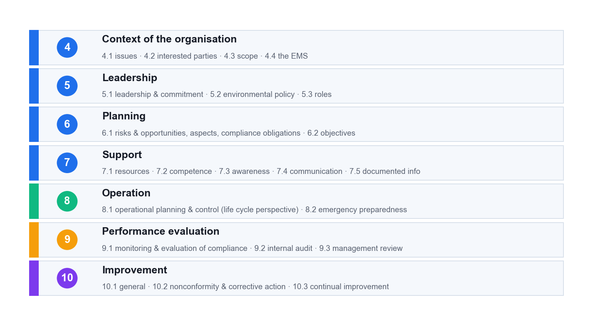

*The Annex SL high level structure. Clauses 4–10 carry every requirement.*

#### Clause 4 — Context of the organisation

| Sub-clause | What the standard requires |
|---|---|
| 4.1 Understanding the organisation and its context | Determine external and internal issues, **including environmental conditions capable of affecting the organisation**. No documented information required. |
| 4.2 Needs and expectations of interested parties | Determine the parties, their relevant needs, and **which of those needs become compliance obligations**. |
| 4.3 Determining the scope of the EMS | Boundaries and applicability. **Maintained as documented information and available to interested parties.** |
| 4.4 Environmental management system | Establish, implement, maintain and continually improve the EMS including the processes needed and their interactions. |

#### Clause 5 — Leadership

| Sub-clause | What the standard requires |
|---|---|
| 5.1 Leadership and commitment | Top management shall **demonstrate** leadership: accountability for EMS effectiveness, integration into business processes, ensuring resources. Non-delegable. |
| 5.2 Environmental policy | Commitments to protection of the environment (including prevention of pollution), to fulfil compliance obligations, and to continual improvement. Maintained, communicated, available. |
| 5.3 Roles, responsibilities and authorities | Assigned **and communicated**. The 2004 'management representative' role is no longer mandatory. |

#### Clause 6 — Planning

| Sub-clause | What the standard requires |
|---|---|
| 6.1.1 General | Determine **risks and opportunities** related to aspects, compliance obligations and 4.1/4.2 issues. Determine potential emergency situations. |
| 6.1.2 Environmental aspects | Determine aspects you **control and influence**, considering a **life cycle perspective**, **change**, **abnormal conditions** and **reasonably foreseeable emergencies**. Determine significance **by established criteria**. |
| 6.1.3 Compliance obligations | Determine and **have access to** them; determine **how they apply**; take them into account in the EMS. |
| 6.1.4 Planning action | Plan action on significant aspects, compliance obligations and risks and opportunities; integrate into EMS processes; **evaluate effectiveness**. |
| 6.2.1 / 6.2.2 Environmental objectives | Measurable if practicable, monitored, communicated, updated. Plan: **what · resources · who · when · how evaluated (with indicators)**. |

#### Clause 7 — Support

| Sub-clause | What the standard requires |
|---|---|
| 7.1 Resources | Determine and provide what the EMS needs. |
| 7.2 Competence | For work affecting environmental performance **and the ability to fulfil compliance obligations** — includes contractors. **Retain** evidence. |
| 7.3 Awareness | Policy · the significant aspects related to **their** work · their contribution to EMS effectiveness · implications of not conforming. Test by interview. |
| 7.4 Communication | What · when · with whom · how. Internal communication must let staff **contribute to continual improvement**. |
| 7.5 Documented information | Creating and updating (identification, format, review and approval) and control (availability, protection, distribution, storage, change, retention). |

#### Clause 8 — Operation

| Sub-clause | What the standard requires |
|---|---|
| 8.1 Operational planning and control | Establish **operating criteria** and control to them. Control planned change; review unintended change. **Outsourced processes controlled or influenced.** Life cycle: design, procurement, external providers, end-of-life information. |
| 8.2 Emergency preparedness and response | Prepare · respond · mitigate · **periodically test** · review and revise (especially after an incident or test) · inform and train. |

#### Clause 9 — Performance evaluation

| Sub-clause | What the standard requires |
|---|---|
| 9.1.1 Monitoring, measurement, analysis and evaluation | What · methods ensuring valid results · **criteria and indicators** · when. Equipment **calibrated or verified**. |
| 9.1.2 Evaluation of compliance | Determine **frequency**; evaluate and **act if needed**; **maintain knowledge and understanding of compliance status**. |
| 9.2.1 / 9.2.2 Internal audit | At planned intervals, against ISO 14001 **and the organisation's own requirements**, and for **effective implementation**. Programme considers **environmental importance, changes and previous results**; auditors selected for **objectivity and impartiality**. |
| 9.3 Management review | Seven required inputs; six required outputs — including **implications for the strategic direction** of the organisation. |

#### Clause 10 — Improvement

| Sub-clause | What the standard requires |
|---|---|
| 10.1 General | Determine improvement opportunities from 9.1, 9.2 and 9.3. |
| 10.2 Nonconformity and corrective action | React and correct (**including mitigating environmental impacts**) · evaluate the need to **eliminate the cause** · check whether similar NCs exist elsewhere · implement · **review effectiveness** · change the EMS if needed. |
| 10.3 Continual improvement | Continually improve suitability, adequacy and effectiveness **to enhance environmental performance**. |

#### Documented information — maintain vs retain

The standard uses **maintain** for a document (how to do it) and **retain** for a record (evidence it was done). There are 15 mandatory items.

| MAINTAIN (7 documents) | RETAIN (8 records) |
|---|---|
| 4.3 scope | 6.2.1 environmental objectives |
| 5.2 environmental policy | 7.2 evidence of competence |
| 6.1.1 risks and opportunities | 7.4.1 evidence of communications |
| 6.1.2 aspects, criteria, significant aspects | 9.1.1 monitoring and measurement results |
| 6.1.3 compliance obligations | 9.1.2 compliance evaluation results |
| 8.1 operational control | 9.2.2 audit programme and audit results |
| 8.2 emergency preparedness | 9.3 management review results |
| — | 10.2 nature of NCs, actions taken, and corrective action results |

> **DO NOT RAISE THESE —** There is **no required documented procedure** anywhere in ISO 14001:2015, **no environmental manual**, and **no preventive action procedure** (preventive action was deleted in the 2015 revision — clause 6.1 replaces it). Raising a nonconformity for any of these is a common and avoidable auditor error.

### 2.4 Aspects, Impacts and Compliance Obligations  [K2]

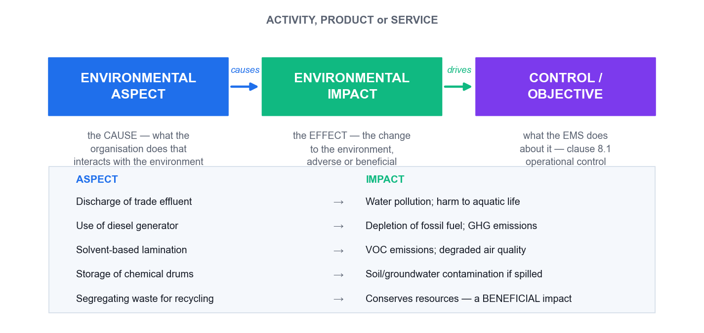

*The aspect is the cause you control; the impact is the effect on the environment.*

The **aspect** is the element of your activity that interacts with the environment. The **impact** is the resulting change to the environment — which may be **adverse or beneficial**.

| Activity | Aspect (cause) | Impact (effect) | Condition |
|---|---|---|---|
| PCB washing | Discharge of trade effluent containing copper | Watercourse contamination; aquatic toxicity | Normal |
| Solvent lamination | Emission of VOCs | Air pollution; photochemical smog | Normal |
| Boiler operation | Emission of SO₂, NOₓ, particulates | Air pollution; acid deposition | Normal |
| Chiller operation | HFC refrigerant leakage | GHG emissions (high GWP); climate change | Abnormal |
| Boiler cold start | Elevated smoke and CO emissions | Air pollution — often the worst hourly rate | Start-up |
| Chemical drum storage | Potential release from bund failure | Soil and groundwater contamination | **Emergency** |
| Waste segregation | Recovery of recyclable material | Conserves resources — **beneficial** | Normal |

> **RED FLAG —** A register with **no beneficial aspects** and **no emergency aspects** has usually been copied rather than built. Ask how it was produced.

#### Four methods for identifying aspects

1. **Process mapping** — Flowchart each process step and interrogate every step for an environmental interaction.
2. **Input–output analysis** — List what goes IN (materials, water, energy, chemicals, packaging) and what comes OUT (product, emissions, effluent, solid waste, noise, heat, odour). The **mass balance** is the auditor's best question: *'you purchased 500 L of solvent and disposed of 120 L — where did the other 380 L go?'* The answer is usually a fugitive emission that is not in the register.
3. **Site walkthrough** — Walk the drains, stacks, vents, bunds, skips and storage areas. This catches the informal and undocumented.
4. **Life cycle stages** — Raw materials → design → production → transport → use → end of life. Catches indirect aspects outside the fence.

#### Compliance obligations in the Singapore context

**Legal requirements** are what the organisation has to comply with. **Other requirements** are what it has to or chooses to comply with — and a voluntary commitment becomes auditable the moment the organisation adopts it (clause 4.2(c)).

| Regime | Regulator | Evidence to ask for |
|---|---|---|
| Air emissions (EPMA) | NEA | Source emission test reports from an accredited laboratory; stack/CEMS records; **calibration certificates** |
| Trade effluent to public **sewer** | PUB | **Written Approval** and its conditions; sampling results; pre-treatment plant O&M logs; sanitary drainage plan |
| Trade effluent to **watercourse** | NEA | Discharge limits (pH 6–9, TSS 50 mg/L, COD 100 mg/L to watercourse); accredited laboratory analyses |
| Toxic industrial waste | NEA | Collector's licence **covering that specific waste**; electronic consignment notes (WRMS); transport approvals |
| General waste | NEA | Contractor's **General Waste Collector licence** (1-year validity); disposal tickets and weighbridge slips |
| Boundary noise | NEA | Monitoring with a **Type 1** sound level meter; calibration certificates; complaint register |
| Carbon tax | NEA | Registration; Monitoring Plan; **verified** Emissions Report; activity data and instrument calibration |
| Hazardous substances | NEA | Hazardous Substances Licence and per-consignment permits; transaction records; Safety Data Sheets |
| Energy Conservation Act | NEA | Registration if ≥ 54 TJ/yr in 2 of 3 preceding years; appointed Energy Manager; annual energy efficiency improvement plan |

> **VERIFIED AS AT AUGUST 2026 —** Carbon tax is **S$45/tCO₂e for 2026–2027**; a facility is **taxable at ≥ 25,000 tCO₂e** and **reportable at ≥ 2,000 tCO₂e**. Limits, thresholds and rates change. Audit the **method** by which the legal register is kept current (clause 6.1.3) and compliance is evaluated (clause 9.1.2) — do not treat any figure as permanent, and always date the figures in a legal register.

### 2.5 Risks and Opportunities — and Objectives  [K2]

**Risks and opportunities (6.1.1) are not the same as environmental aspects (6.1.2).** Aspects are your physical interaction with the environment. Risks and opportunities are threats and opportunities to the **EMS achieving its intended outcomes** — and aspects are only one of their three inputs, alongside compliance obligations and the 4.1/4.2 issues.

> **COMMON FAILURE —** Relabelling the aspect register as the 'risk register' does **not** satisfy clause 6.1.1.

**Clause 6.2.2** requires five things for every objective. Use this as a checklist:

| Requirement | The question | A weak answer |
|---|---|---|
| What will be done | What are the actual actions? | 'Improve energy efficiency' — that is the objective, not the plan |
| What resources | Is the budget approved and released? | No capex and no headcount — a paper objective |
| Who is responsible | Which **named role** owns it? | 'The EHS department' |
| When completed | Target date and milestones? | 'Ongoing' |
| How evaluated | Which indicator, measured how and how often? | No indicator, or one with no calibrated measurement |

## 3. Topic 2 — Auditing ISO 14001:2015

**LU2: Auditing Methodologies**  ·  **LO2**  ·  Knowledge/Ability: **K3 · A2**

### 3.1 The Seven Audit Principles (ISO 19011:2018 Clause 4)  [K3]

| Principle | What it means |
|---|---|
| Integrity | The foundation of professionalism — work honestly, diligently and responsibly. |
| Fair presentation | Report truthfully and accurately — including unresolved disagreements between the team and the auditee. |
| Due professional care | Diligence and judgement appropriate to the importance of the task and the confidence placed in you. |
| Confidentiality | Security of information — do not use it for personal gain or to the auditee's detriment. |
| Independence | The basis for impartiality and objectivity — auditors do not audit their own work. |
| Evidence-based approach | The rational method for reaching reliable and **reproducible** conclusions. |
| Risk-based approach | Consider risks and opportunities — new in the 2018 edition. |

### 3.2 The Audit Programme vs the Individual Audit  [K3]

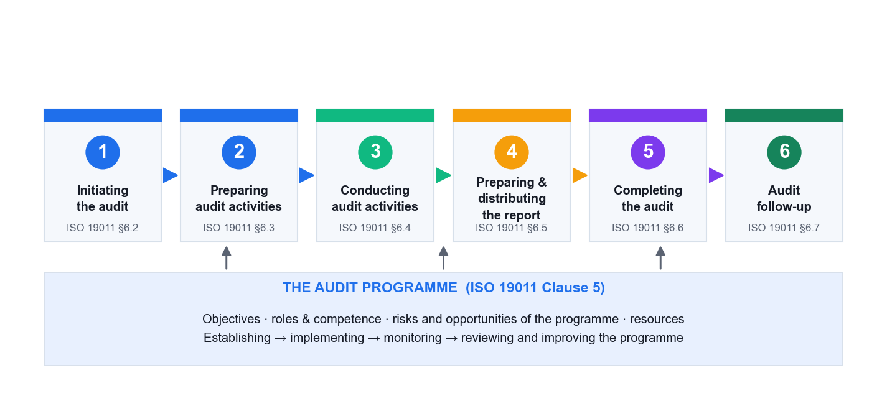

*Clause 5 manages the programme (the year). Clause 6 conducts one audit.*

This distinction matters because most weaknesses you will find are **programme** weaknesses, and fixing one improves every future audit.

| Programme-level finding (ISO 14001 cl. 9.2.2) | Audit-level finding (this one audit) |
|---|---|
| The audit procedure has not been updated after major change | The checklist does not cover the audit criteria |
| Equal audit time regardless of environmental risk | Evidence not verified before a finding was raised |
| Previous nonconformities closed without verification | A nonconformity statement missing its evidence |
| Auditors not competent or not impartial | No opening or closing meeting held |
| Results not reported to relevant management | The report omits the sampling limitation |

### 3.3 The Six-Stage Audit Lifecycle  [K3, A2]

#### Stage 1 — Initiating the audit  (§6.2)

- Establish contact with the auditee and confirm your authority to audit.
- Confirm the audit is **feasible** — availability of information, cooperation, time and resources, and (critically) **access to every location in scope**.

#### Stage 2 — Preparing audit activities  (§6.3)

- **Review documented information**: the EMS documentation, previous audit reports and open corrective actions, the aspects register, the legal register, licences and monitoring data. Determine adequacy before you go on site.
- **Prepare the audit plan**: objectives, criteria, scope, locations, dates and times, methods, roles, and the opening and closing meeting times.
- **Assign work** to the audit team.
- **Prepare work documents** — the checklist and evidence-recording forms.
- **Decide the sampling approach** and be ready to justify it.

#### Stage 3 — Conducting audit activities  (§6.4)

- Hold the **opening meeting**.
- **Collect and verify** information — interview, observe, read documents, check records. Only verified information becomes audit evidence.
- **Generate audit findings** by evaluating evidence against the audit criteria.
- **Prepare audit conclusions** with the team.
- Hold the **closing meeting**.

#### Stage 4 — Preparing and distributing the report  (§6.5)

- Write the report so a reader who was not there understands what was found, where, and against which requirement.
- Distribute it to the recipients defined in the audit plan and to relevant management (ISO 14001 cl. 9.2.2).

#### Stage 5 — Completing the audit  (§6.6)

- Complete all planned activities, retain or dispose of documents as agreed, and formally close the audit.

#### Stage 6 — Conducting audit follow-up  (§6.7)

- Verify that corrective actions were implemented **and effective** — required by ISO 14001 cl. 10.2(d).
- This is the stage most often skipped, and skipping it is what turns 'closed' findings into repeat findings.

### 3.4 Building the Audit Checklist  [K3]

A good checklist is **organisation-specific** and **risk-weighted**, and every line has three columns.

| Clause / requirement | The question I will ask | The evidence I expect to see |
|---|---|---|
| 6.1.2 aspects · change | How were aspects re-assessed after the new line was commissioned? | Dated register entry for the new process; the change record |
| 6.1.3 compliance obligations | Which discharge limits apply to you, and how did you determine that? | Licence / Written Approval; legal register with applicability noted |
| 7.2 competence | How did you determine the competence needed for this role? | Competence matrix; training records; evidence of effectiveness |
| 8.1 operational control | What are the operating criteria for this process? | Work instruction with limits; monitoring records against them |
| 9.1.1 monitoring | How do you know that monitoring result is valid? | **Calibration certificate in date**; accredited laboratory report |
| 9.1.2 evaluation of compliance | How often do you evaluate compliance, and what did the last one find? | Compliance evaluation record and the actions arising |
| 10.2 corrective action | How did you verify last year's corrective action worked? | Effectiveness review record — not merely a 'closed' status |

> **AVOID —** A generic clause-by-clause tick-list. It is the single most common weakness in internal audit practice: it produces the same findings every year and misses everything that actually changed.

### 3.5 Audit Evidence and Sampling  [K3]

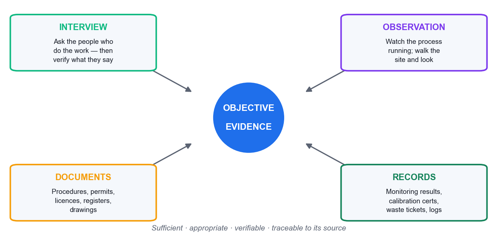

*Objective evidence comes from four sources — verify across at least two.*

Evidence must be **sufficient** (enough of it) and **appropriate** (relevant and reliable), and **traceable** to its source.

- **Interview** — what people say. The weakest form on its own; always verify.
- **Observation** — what you see happening. Strong, but a snapshot in time.
- **Documents** — what is supposed to happen (procedures, permits, licences).
- **Records** — evidence that it did happen (results, certificates, logs).
**Sampling.** You cannot audit everything. Judgement-based sampling selects by risk (the newest process, the biggest aspect, the area with previous findings, the shift nobody watches); statistical sampling allows a confidence level to be stated. Record **what you sampled and why** — and put the sampling statement in the report.

> **THE TEST —** If you cannot explain why you looked at those three drums and not the other forty, your finding is vulnerable at the closing meeting.

### 3.6 Questioning Technique  [A2]

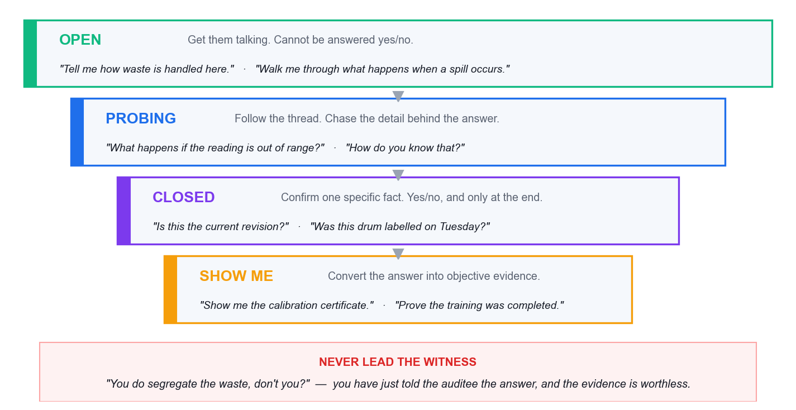

*The funnel: open → probing → closed → verify. Roughly 70% open/probing.*

| Type | Use it to | Example |
|---|---|---|
| Open | Open a topic and let them talk | *'Walk me through what happens to the waste solvent.'* |
| Probing | Push past the rehearsed answer | *'What happens if the reading is out of range?'*  *'How do you know?'* |
| Clarifying | Remove ambiguity before you write anything down | *'When you say the bund is checked — by whom, and is it recorded?'* |
| Closed | Confirm one specific fact, at the END | *'Is this the current revision?'* |
| Verify ('show me') | Convert the answer into objective evidence | *'Show me the calibration certificate.'* |
| **Leading — never** | Contaminates the evidence | *'You do calibrate that, don't you?'* |

#### 5W1H — so you miss no dimension

|  | The question | Applied to an EMS process |
|---|---|---|
| What | What is done? What is the requirement? | What environmental aspects arise from this activity? |
| Why | Why this way? Why this control? | Why was this aspect rated not significant? |
| Who | Who does it? Who is competent or authorised? | Who is authorised to sign the waste consignment note? |
| Where | Where is it done? Where is it recorded? | Where is the spill kit, and where is the nearest drain? |
| When | When and how often? When last? | When was the emergency response last tested? |
| How | How is it controlled, measured, verified? | How do you verify the disposal contractor is licensed? |

Two extensions worth using: **'how much / how many'** quantifies, and **'what if'** tests the abnormal and emergency conditions that clauses 6.1.2 and 8.2 require.

#### PLOD — capturing traceable evidence as you find it

PLOD is a note-taking discipline (not an ISO term). Every observation in your working papers should carry as many of these as apply:

|  | Capture | Example |
|---|---|---|
| **P** — Person | The **role**, never the individual's name | 'the Warehouse Supervisor' |
| **L** — Location | Building, area, line, tank | 'Chemical Store B, external yard' |
| **O** — Object | The physical thing with its identifier | 'three 200 L drums, IDs WD-104/105/106' |
| **D** — Document | Document identity **and revision or date** | 'EMS-P-08 Rev 4, cl. 5.3' |

> **THE TEST OF A GOOD NOTE —** If your note carries none of P, L, O or D, you have an impression, not evidence. A finding must be **re-findable** six months later by someone else.

#### What NOT to do in an interview

- **Leading questions** — they supply the answer and destroy the evidence.
- **Compound questions** — you will only get the last one answered.
- **Interrogating** — rapid-fire closed questions with no pauses.
- **Talking more than the auditee** — target under 30% of the airtime.
- **Filling the silence** — after a question, wait. The pause does the work.
- **Consulting mid-audit** — you become the author of what you must audit next year, and you lose independence.
- **Auditing the person** — 'why didn't *you* fill this in?' Reframe: 'what makes it hard to complete this log at shift change?'
- **Naming individuals in findings** — findings address the system.
- **Interviewing only managers** — the manager describes the procedure; the operator reveals the practice.
- **Accepting 'we always do it that way'** — that is an assertion. Show me.

### 3.7 Opening and Closing Meetings  [A2]

#### Opening meeting agenda

1. Introductions and roles — audit team, auditee representatives, guides.
2. Confirm the audit plan: objectives, scope, criteria, timetable, closing meeting time.
3. Confirm communication channels and how issues will be escalated.
4. Explain the audit method and the **sampling basis**, and that sampling means the audit carries an element of uncertainty.
5. Explain how findings will be **graded and reported**.
6. Confirm safety, escort and facility arrangements.
7. Invite questions and confirm agreement before fieldwork begins.

#### Closing meeting agenda

1. Thank the auditee; restate the audit objective and scope.
2. **Restate the sampling caveat** — absence of a finding is not proof of conformity.
3. Present the findings, each with its evidence and grade, so they are understood and acknowledged.
4. Present the audit conclusion on conformity **and** effective implementation.
5. Agree the corrective action process, owners, timeframes and how effectiveness will be verified.
6. **Record any diverging opinions** — unresolved disagreements are reported, never suppressed.
7. Confirm report distribution, timing and the follow-up arrangement.

### 3.8 Engaging the Stakeholders  [A2]

| Group | What you need from them | How to engage |
|---|---|---|
| Operations staff | What ACTUALLY happens | Interview at their normal workplace, put them at ease, open questions, never blame |
| Process owners / managers | The intended procedure and ownership of actions | Structured interview; then contrast what they say with what you observed |
| Top management | Leadership (5.1), resources (7.1), programme decisions | Opening and closing meetings; direct interview for clause 5 |
| Client representatives | Site access and permission | **Not the auditee** — arrange in advance, observe their site rules, protect confidentiality both ways |
| Regulators (NEA, PUB) | The compliance position | **Indirectly** — licences, submitted returns, correspondence, notices. An internal auditor does not interview the regulator |
| Contractors on site | Competence and control of outsourced work | They work 'under the control of' the organisation — clauses 7.2 and 8.1 apply to them |

## 4. Topic 3 — Risk Assessment

**LU3: Risk Assessment Techniques**  ·  **LO3**  ·  Knowledge/Ability: **K4 · A3**

### 4.1 Conducting the Risk Assessment  [K4]

ISO 14001 **prescribes no method** for determining significance. Clause 6.1.2 requires only that significant aspects are determined **by established criteria**, and that the criteria are documented. So the audit question is never *'is your method right?'* — it is *'is your method documented, criteria-based, consistently applied and reproducible?'*

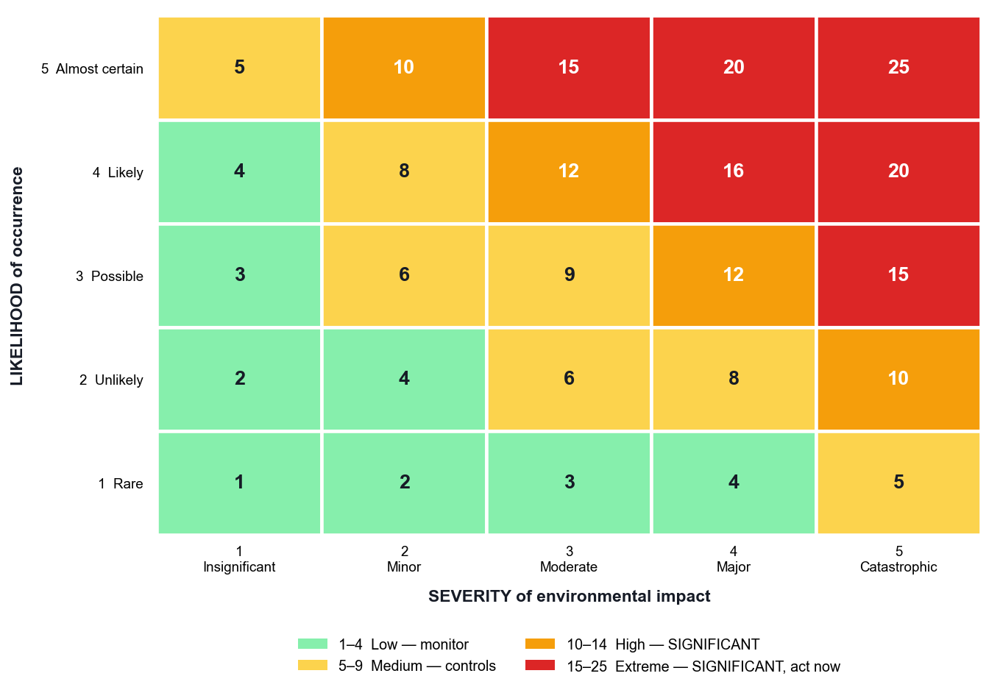

*A 5×5 matrix: score = severity × likelihood. Significant at ≥ 10.*

#### Method 1 — Severity × Likelihood (5×5)

| Score | Band | Action |
|---|---|---|
| 1–4 | Low | Not significant — maintain existing controls, review annually |
| 5–9 | Medium | Not significant — existing operational control, monitor |
| 10–14 | High | **SIGNIFICANT** — documented operational control (8.1) + monitoring (9.1) |
| 15–25 | Extreme | **SIGNIFICANT — priority** — objective/programme required (6.2), escalate to management review |

#### The override rules — what makes an aspect significant regardless of score

- It is subject to a **legal limit, licence or permit condition**.
- It has attracted a **regulatory notice, warning, fine or prosecution** in the last three years.
- It has generated a **substantiated external complaint**.
- It involves a **listed hazardous substance or toxic industrial waste**.

> **WHY THIS MATTERS —** Without override rules a licensed discharge can score 'medium' and drop off the significant list. That is the classic finding where the aspects register has become disconnected from the legal register.

#### Method 2 — Multi-criteria scoring

Score = **Severity × Frequency × Legal exposure × Stakeholder concern**, each 1–5. This builds compliance obligations (6.1.3) and interested parties (4.2) into the evaluation explicitly, which suits larger organisations. A weighted sum avoids the 'score explosion' of pure multiplication; the weights themselves then become documented criteria you must be able to justify.

#### Method 3 — FMEA for environmental risk

| Dimension | What it rates | The insight |
|---|---|---|
| Severity (S) | How bad the environmental consequence is, 1–10 | Usually cannot be reduced — a solvent stays toxic |
| Occurrence (O) | How likely the failure mode is, 1–10 | Reduced by maintenance, design and competence |
| Detection (D) | Ability to detect **before** impact — inverted scale, 1 = almost certain detection | The **cheapest and fastest** way to reduce risk |
| RPN = S × O × D | 1–1000; act at ≥ 100; any **S ≥ 9** acts regardless | Links straight to clause 9.1 monitoring |

**Worked example.** A cracked bund on a solvent tank: S = 9 (major off-site contamination), O = 4 (concrete degradation over years), D = 7 (monthly visual check only) → **RPN 252 — critical**. Install a leak-detection sensor and D falls to 2 → **RPN 72**. Same hazard, same likelihood — but now you find out before it reaches the soil.

#### Auditing the significance method — questions that find weakness

| Ask this | A weak answer looks like |
|---|---|
| Show me the documented criteria for significance. | Criteria exist only in a spreadsheet formula or in someone's head |
| Who approved these criteria, and when? | No approval, no date, no version control |
| Would two assessors score this aspect the same? (Test it live.) | No calibration, no worked guidance, no examples |
| This aspect has a legal limit but scored 6. Explain. | No override rule for compliance obligations |
| Show me how each significant aspect flows to a control and to monitoring. | The register is standalone shelf-ware that nothing references |
| Why did significant aspects drop from 30 to 6 last year? | The threshold was quietly moved to reduce workload |

### 4.2 Writing Effective Nonconformity Statements  [A3]

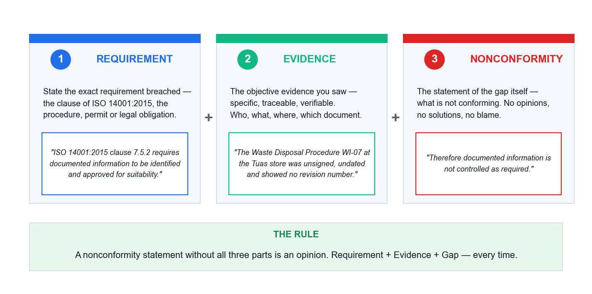

*Requirement + Evidence + Gap. Miss one and you have written an opinion.*

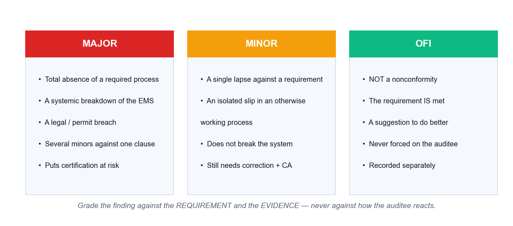

*Major, minor and OFI. The grading criteria come from your own audit procedure.*

> **WHERE GRADING CRITERIA COME FROM —** ISO 19011 says only that findings *'can be graded'*. The major/minor criteria come from ISO/IEC 17021-1 and from **your organisation's own audit procedure**. Define them there and apply them consistently.

#### Bad and good — rewrite every weak statement

| Weak | Why it fails | Strong |
|---|---|---|
| 'Housekeeping in the chemical store is poor.' | Opinion; no requirement, no evidence | 'ISO 14001:2015 cl. 8.1 requires operational controls... On 14 Aug 2026 three 200 L drums (WD-104/105/106) in Chemical Store B bore no contents or hazard labels... therefore operational control for hazardous waste storage is not implemented as required.' |
| 'The operator did not follow the procedure.' | Blames a person; names no requirement | State the requirement, the observed evidence, and the systemic gap — not the individual |
| 'You should install a new bund.' | That is consulting, not a finding | State the nonconformity; let the auditee design the corrective action |
| 'Training records were not very good.' | Vague; not traceable; not re-findable | Name the clause (7.2), the specific records examined, and what was missing from them |

### 4.3 Root Cause Analysis and Corrective Action  [A3]

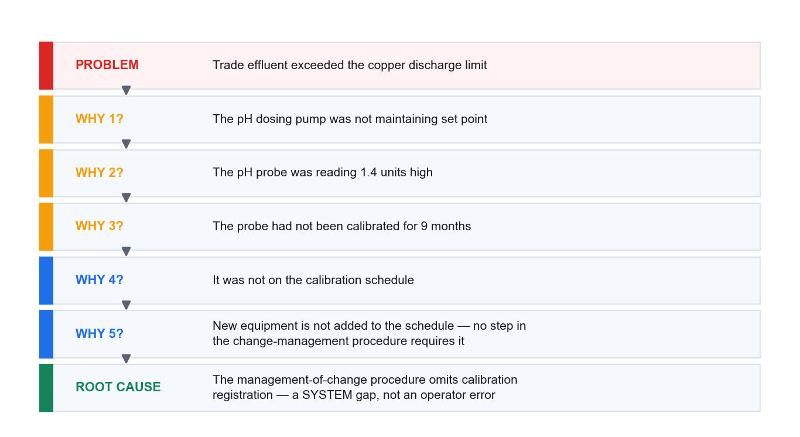

*5 Whys: stop at a process gap, never at a person.*

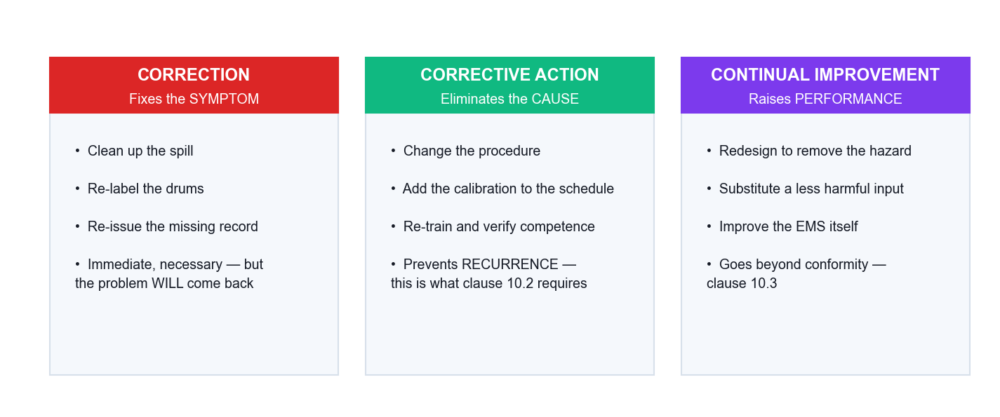

*Clause 10.2 requires BOTH correction and action to eliminate the cause.*

**Correction** fixes the symptom (clean the spill, re-label the drum). **Corrective action** eliminates the cause so it does not recur or occur elsewhere (change the procedure, add the step, fix the schedule). Clause 10.2 requires both — a CAR that lists only corrections is incomplete.

#### The anatomy of a corrective action request

1. **The nonconformity statement** — requirement + evidence + gap, with the clause.
2. **The grade and its justification** — major, minor or OFI, against your defined criteria.
3. **Root cause** — reached by 5 Whys or fishbone; must be a **process or system** cause.
4. **Correction** — what fixes the immediate problem and mitigates the environmental impact (10.2a).
5. **Corrective action** — what eliminates the cause, plus whether **similar nonconformities exist elsewhere** (10.2b).
6. **Owner and due date** — a named role and a real date.
7. **Effectiveness verification** — how and when you will confirm it worked (10.2d), retained as documented information.

| Weak corrective action | Strong corrective action |
|---|---|
| 'Operator re-trained.' | 'Amended management-of-change procedure PR-12 to require an environmental re-assessment before any volume or process change — effective 1 Sep 2026, owner: EHS Manager.' |
| 'Reminded staff at the toolbox talk.' | 'Added bund integrity testing to the planned maintenance schedule at 12-month frequency, owner: Facilities Manager.' |
| 'Increased management awareness.' | 'Installed continuous pH monitoring with an interlocked shut-off on the discharge line.' |
| 'Will monitor more closely.' | Named owner, stated frequency, defined acceptance criterion, and a date for the effectiveness review |

> **THE TEST —** Would this corrective action survive the person leaving tomorrow? If not, you have a correction dressed up as a corrective action. Re-training is sometimes right — but only when the root cause genuinely is a competence gap, and then clause 7.2 requires you to evaluate the effectiveness of that training.

### 4.4 Preparing the Audit Report  [A3]

1. **Audit objectives, scope and criteria** — including anything excluded.
2. **Audit team, auditees and dates.**
3. **The audit findings**, each with its evidence, its clause and its grade.
4. **The audit conclusion** — on conformity **and** on effective implementation and maintenance (ISO 14001 cl. 9.2.1 requires both).
5. **The sampling statement** — that the audit was a sampling exercise and therefore carries uncertainty. This is the **most commonly omitted element** of real internal audit reports, and it protects both you and the organisation.
6. **Opportunities for improvement**, kept clearly separate from nonconformities.
7. **Agreed actions, owners and due dates**, and the follow-up arrangement.
8. **Distribution list** — results must be reported to relevant management.

## 5. Hands-On Activities

Each activity is a case study run in small groups and debriefed by the trainer. Work through the steps in order; the questions at the end of each activity are deliberately similar in shape to the final assessment.

### Activity 1 — Auditing GreenPack — Framework, Context and Scope

**Topic 1**  ·  **45 minutes**  ·  Assesses **K1 · K2 · A1**

#### Scenario

**GreenPack Manufacturing Pte Ltd** is a Singapore company producing biodegradable packaging materials from a single leased facility in Tuas. It achieved ISO 14001:2015 certification two years ago and employs 150 staff across three departments: Production, Warehousing & Logistics, and Administration.

Eight months ago the company expanded production capacity by 40% and introduced a new **thermal lamination process using solvent-based adhesives**. Since the expansion:

- electricity consumption has risen by 25%;
- volatile organic compound (VOC) emissions from the lamination line have increased;
- **three customer complaints** about chemical odours from the packaging have been received;
- one **neighbouring tenant** has complained informally to the landlord about solvent smell.
The Environmental Policy was last reviewed 18 months ago and makes no reference to the new process. The environmental aspects and impacts register has **not been updated since the expansion**. The company's strategic plan carries an objective to **reduce its carbon footprint by 30% within three years**. The internal audit function follows the **International Professional Practices Framework (IPPF)**.

You are the lead internal auditor. The Managing Director has directed the internal audit team to conduct a comprehensive EMS audit and wants the scope agreed this week. You have been given the Environmental Policy, the (stale) aspects register, the organisation chart and the strategic plan.

#### The evidence you have been given

- Certified to ISO 14001:2015 for 2 years; single leased site in Tuas; 150 staff.
- Capacity +40%; new solvent-based thermal lamination line commissioned 8 months ago.
- Electricity consumption +25%; VOC emissions increased.
- 3 customer odour complaints; 1 informal neighbour complaint via the landlord.
- Environmental Policy last reviewed 18 months ago — does not mention lamination.
- Aspects & impacts register not updated since the expansion.
- Strategic objective: reduce carbon footprint 30% in 3 years.
- Internal audit function operates under the IPPF.
- You report to the Audit Manager; you have never worked in Production.

#### Step-by-step method

**Step 1: Establish your professional basis under the IPPF**

List the four mandatory IPPF components and state, in one line each, how they govern THIS engagement: the Definition of Internal Auditing (independent, objective assurance adding value); the Code of Ethics (integrity, objectivity, confidentiality, competency); the Core Principles; and the International Standards. Note explicitly that you have never worked in Production — record that your independence is intact.

**Step 2: Convert each symptom into a clause hypothesis**

Take every fact in the scenario and ask 'which ISO 14001:2015 requirement would have prevented this?'. Stale policy -> 5.2. Stale aspects register after a process change -> 6.1.2 (change is explicitly named). Odour and VOC -> 6.1.2, 8.1 operational control, 6.1.3 compliance obligations. Neighbour and customer complaints -> 4.2 interested parties and 7.4 communication. Energy +25% against a carbon objective -> 6.2, 9.1.1.

**Step 3: Build the context table (clause 4.1 / 4.2)**

Three columns: EXTERNAL issues (NEA air-quality regulation, landlord lease terms, customer sustainability expectations, solvent price), INTERNAL issues (new process, capacity change, competence of new operators, ageing policy), and INTERESTED PARTIES with their relevant needs (NEA, landlord, neighbouring tenants, customers, employees). Then apply clause 4.2(c): mark which of those needs the organisation has ADOPTED as compliance obligations.

**Step 4: Test the declared EMS scope (clause 4.3)**

Ask whether the certified scope still covers what the company actually does. A 40% capacity increase and a brand-new process either fall inside the existing scope statement or reveal that the scope was never updated. Record which, and the evidence you would request to confirm it.

**Step 5: Prioritise the audit by risk, not by department**

Rank the areas: lamination line and its emissions (highest — new, uncontrolled, complaints, legal exposure); aspects/risk management process; policy and management review; energy and the carbon objective; warehousing; administration (lowest). State the reason for each rank in one line — this is what makes the plan defensible.

**Step 6: Write the engagement scoping note**

One page: audit objective, criteria (ISO 14001:2015 + GreenPack's own EMS procedures + applicable compliance obligations), scope and boundaries, areas prioritised with rationale, auditor independence statement, and the documents you will request before fieldwork.

#### Questions to answer

**Q1. Which IPPF components govern your conduct on this engagement, and what does each require of you here?**

*What a good answer contains:* Expect all four mandatory elements named, each tied to a concrete action in this case (e.g. Objectivity — you must not audit work you performed; Competency — you may need technical support on solvent chemistry).

**Q2. Which ISO 14001:2015 clauses are most relevant to GreenPack's situation, and why is each applicable?**

*What a good answer contains:* Look for 6.1.2 (change / stale register) and 5.2 (stale policy) as the two strongest, plus 4.1, 4.2, 4.3, 6.1.3, 6.2, 7.4, 8.1, 9.1.1 and 9.3, each justified by a specific fact from the scenario — not a generic clause list.

**Q3. How should GreenPack's risks, objectives, resources and operational changes shape the scope and focus of your audit plan?**

*What a good answer contains:* The answer must move from risk to scope: the highest-risk, most-changed, most-complained -about area gets the most audit time. Equal time per department is the wrong answer.

#### Self-check

> **YOU ARE DONE WHEN —** Your scoping note names at least 8 relevant clauses each tied to a specific scenario fact, ranks the lamination line as the top priority with a stated reason, and contains an explicit auditor-independence statement.

#### If you are stuck — what usually goes wrong

- You listed clauses but did not tie each one to a fact from the scenario — the clause map must be evidence-led, not a contents page.
- You allocated equal audit time to all three departments. Audit effort follows environmental risk and change; say so and defend it.
- You treated the odour complaints as the finding. They are a SYMPTOM — the stale aspects register is the systemic issue.
- You forgot the independence statement. The IPPF requires objectivity to be considered and recorded before the engagement starts.
- You wrote 'the policy is old' without naming clause 5.2 and what it requires.

#### Model answer

**IPPF.** The Definition frames the work as independent, objective assurance that adds value. The **Code of Ethics** binds the auditor to Integrity, Objectivity, Confidentiality and Competency — here, objectivity is satisfied because the auditor has never worked in Production, and competency may require a technical specialist on solvent emissions. The **Core Principles** and the **International Standards** require the engagement to be risk-based, adequately planned and reported to those charged with governance.

**Clause map.** 4.1 — the new process and rising energy cost are internal issues; NEA air regulation and the landlord's lease are external. 4.2 — neighbours, customers, NEA and the landlord are interested parties whose expectations may become compliance obligations under 4.2(c). 4.3 — the EMS scope must still be valid after a 40% expansion. **5.2 — the policy has not been reviewed since a material process change and does not cover lamination: a likely nonconformity.** **6.1.2 — the standard explicitly requires aspects to be determined considering change, including new or modified activities; the register is 8 months out of date: a likely major.** 6.1.3 — VOC discharge triggers EPMA/air-impurities obligations that must be identified. 6.2 — the 30% carbon objective is contradicted by a 25% energy rise. 7.4 — three customer complaints and a neighbour complaint test the communication process. 8.1 — operational control and operating criteria for the new line. 9.1.1 — is VOC and energy performance being monitored at all? 9.3 — did management review consider the change?

**Scope.** Objective: determine whether the EMS conforms to ISO 14001:2015 and to GreenPack's own requirements, and is effectively implemented, with particular regard to the capacity expansion and the lamination process. Boundaries: the Tuas site, all three departments, EMS activity from the date of the expansion. Priority order: (1) lamination line — aspects, controls, emissions, legal; (2) the aspect-identification and change-management process itself; (3) policy, objectives and management review; (4) energy performance vs the carbon objective; (5) warehousing; (6) administration. Equal time per department would be indefensible: audit effort follows environmental risk and change.

#### Trainer debrief

Draw out three points. First, **the stale aspects register is the systemic finding** — everything else (odour, VOC, complaints) is a symptom of a change-management process that does not trigger a re-evaluation of aspects. Second, **clause 6.1.2 names 'change' explicitly**, so this is not an auditor's opinion but a requirement breach. Third, **scope is a risk decision**: the group that allocated equal time to all three departments should defend that against the group that front-loaded the lamination line.

### Activity 2 — AquaPure — Planning the Engagement and the Audit Checklist

**Topic 2**  ·  **60 minutes**  ·  Assesses **K3 · A2**

#### Scenario

**AquaPure Water Treatment Services Ltd** provides industrial water-treatment solutions to factories and commercial buildings across Southeast Asia. It runs a **central treatment plant** and deploys **mobile treatment units to client sites**.

AquaPure recently won a large government contract to treat wastewater from a new industrial park, which has **tripled its operational workload**. The EMS Manager has scheduled an internal audit of the wastewater treatment operations.

During your preliminary review you discover:

- the internal audit procedure was written **five years ago** and has not been updated for the expanded operations or the government contract requirements;
- the previous audit report (12 months ago) raised **two minor nonconformities** — (1) incomplete training records for mobile unit operators, and (2) inconsistent calibration of pH monitoring equipment. Both were marked **'closed'**, but **no verification evidence was found**;
- four stakeholder groups feature in the audit process: **Operations staff, Client representatives, Regulatory authorities (e.g. NEA), and Senior management**;
- the audit schedule allocates **equal time to all departments**, regardless of risk level or operational significance;
- the Operations Manager is concerned that **mobile unit operators at client sites are not consistently following the effluent discharge monitoring procedures**.

#### The evidence you have been given

- Central plant + mobile units deployed to third-party client sites.
- New government contract tripled the operational workload.
- Internal audit procedure is 5 years old — predates the expansion.
- 2 minor NCs from 12 months ago marked 'closed' with NO verification evidence.
- Stakeholders: Operations staff, Client reps, Regulators (NEA), Senior management.
- Audit schedule gives equal time to every department irrespective of risk.
- Operations Manager suspects mobile operators deviate from discharge monitoring procedures.

#### Step-by-step method

**Step 1: Separate the audit PROGRAMME from THIS audit**

ISO 19011 Clause 5 governs the programme (frequency, methods, responsibilities, resources, monitoring and improvement); Clause 6 governs the individual audit. AquaPure's failures are mostly programme-level: a 5-year-old procedure, equal time regardless of risk, and unverified closures. Record them as programme findings against ISO 14001 clause 9.2.2, which requires the programme to take into account the environmental importance of the processes and the results of previous audits.

**Step 2: Stage 1 — Initiating the audit (§6.2)**

Establish contact with the auditee, confirm the audit's feasibility, and confirm your authority to audit. For AquaPure, feasibility is a genuine question: mobile units operate on CLIENT premises, so site access must be negotiated in advance. If you cannot get access, say so now — not in the report.

**Step 3: Stage 2 — Preparing audit activities (§6.3)**

Review documented information (the audit procedure, the previous report, the CAR records, discharge licences and monitoring data). Prepare the audit plan. Assign work. Prepare work documents — the checklist. Critically, decide your SAMPLING approach: how many mobile units, which clients, which months of monitoring data, and why.

**Step 4: Write the audit plan**

Objective: determine conformity of the wastewater treatment operations with ISO 14001:2015, AquaPure's own procedures and its discharge obligations, and whether the EMS is effectively implemented — with specific attention to mobile operations and to the effectiveness of previous corrective actions. Criteria, scope, dates, auditors, locations (central plant + a sample of client sites), and the timetable including opening and closing meetings.

**Step 5: Build the risk-based checklist**

Eight lines minimum, each with three columns: the CLAUSE, the QUESTION you will ask, and the EVIDENCE you expect to see. Weight it toward the risk: mobile operations, calibration, training/competence, discharge monitoring, and the two previous NCs. A generic clause-by-clause tick-list is the wrong answer — the checklist must be specific to AquaPure.

**Step 6: Attack the unverified closures**

The two 'closed' NCs with no verification evidence are the strongest audit trail in the scenario. ISO 14001 clause 10.2(d) requires the organisation to review the EFFECTIVENESS of corrective action taken, and to retain documented information on the results. Closure without verification is a nonconformity against 10.2 in its own right — and both original NCs must be re-tested to see whether they recurred.

**Step 7: Build the stakeholder engagement matrix**

For each of the four groups record: what you need from them, when in the audit you engage them, how you engage (interview, opening/closing meeting, document request, observation), and the risk of engaging them badly. Note that Client representatives are NOT the auditee — you have no authority over them and need permission and confidentiality care; and Regulators are usually engaged INDIRECTLY through records of correspondence, not interviewed.

**Step 8: Stage 3 — Conducting the audit (§6.4) and the opening meeting**

Run the opening meeting agenda: introductions and roles, confirm the plan and timetable, confirm criteria and scope, confirm communication channels and the guide, explain the sampling basis and its uncertainty, explain how findings will be graded and reported, confirm safety/escort arrangements, and confirm the closing meeting time. Then rehearse ONE interview with a mobile unit operator using the funnel: open -> probing -> closed -> show me.

#### Questions to answer

**Q1. Identify and explain the key stages of the ISO 14001:2015 internal audit engagement for AquaPure. For each stage, describe the specific actions you would take.**

*What a good answer contains:* All six ISO 19011 stages must appear (initiating, preparing, conducting, reporting, completing, follow-up) and — critically — each action must be AquaPure-specific: client-site access, mobile-unit sampling, re-testing the two closed NCs.

**Q2. How should you engage each of the four stakeholder groups to ensure a comprehensive and effective audit?**

*What a good answer contains:* Look for differentiation. Operations staff = the main evidence source, interviewed on site, non-threatening technique. Client reps = access and permission, confidentiality, not the auditee. Regulators = usually via records of correspondence and licences, not interviewed. Senior management = opening/closing meetings, resources, and the programme-level failures.

**Q3. What programme-level (as opposed to audit-level) findings does this scenario reveal?**

*What a good answer contains:* The 5-year-old procedure, equal time regardless of risk, and closure without verification. All three sit against ISO 14001 clause 9.2.2 and ISO 19011 Clause 5.

#### Self-check

> **YOU ARE DONE WHEN —** Your checklist has at least 8 lines, every line names a clause AND the specific evidence you will ask to see, at least 4 lines target mobile operations / calibration / training / the previous NCs, and your matrix treats client representatives differently from the auditee.

#### If you are stuck — what usually goes wrong

- Your checklist is a generic clause-by-clause tick-list. Rebuild it from AquaPure's own risks: mobile units, calibration, training, discharge monitoring.
- You missed the third checklist column. Every line needs the EVIDENCE you expect to see, not just the question.
- You classified the 5-year-old procedure as an audit finding. It is a PROGRAMME finding against ISO 14001 cl. 9.2.2.
- You accepted 'closed' on the two previous NCs. Clause 10.2(d) requires a review of EFFECTIVENESS — no evidence means no closure.
- You planned to interview the regulator. Internal auditors engage NEA indirectly, through licences, returns and correspondence.
- You forgot client-site access. If you cannot reach the mobile units, the audit is not feasible as scoped — raise it at initiation, not in the report.

#### Model answer

**Stages.** *Initiating (§6.2)* — contact the EMS Manager, confirm authority, and resolve access to client sites where mobile units operate; without that access the audit is not feasible as scoped. *Preparing (§6.3)* — review the 5-year-old procedure, the previous report, both CARs, the discharge licence and 12 months of monitoring data; write the plan; build a risk-weighted checklist; define the sample (e.g. 3 of 12 mobile units across 2 client sites, plus 6 months of pH and discharge records). *Conducting (§6.4)* — opening meeting; collect evidence by interview, observation, documents and records; verify what operators say by watching them work and by tracing records; generate findings; closing meeting. *Reporting (§6.5)* — a report stating criteria, scope, sample, findings graded major/minor/OFI, and conclusions on effectiveness. *Completing (§6.6)* — distribute, retain records, close the audit. *Follow-up (§6.7)* — verify the corrective actions, this time with evidence.

**Stakeholders.** *Operations staff* — the primary evidence source; interview on site using open questions, never blame; they will tell you what actually happens if they are not threatened. *Client representatives* — gatekeepers for site access, not auditees; obtain permission in advance, observe their site rules, and keep AquaPure's and the client's information confidential. *Regulatory authorities (NEA)* — normally engaged indirectly: review licences, permits, submitted monitoring returns and any correspondence or warnings; an internal auditor does not interview the regulator. *Senior management* — opening and closing meetings, and the audience for the programme-level findings; they own the resources and the decision to move to risk-based scheduling.

**Programme findings.** The audit procedure has not been maintained (9.2.2 requires the programme to consider changes affecting the organisation — the workload tripled). Equal time regardless of risk contradicts 9.2.2's requirement to consider the environmental importance of the processes concerned. And closure of both prior NCs without verification evidence breaches 10.2(d) and 10.2's retention requirement.

#### Trainer debrief

Three teaching points. First, **most of AquaPure's problems are programme problems, not audit problems** — this is the distinction no commercial competitor teaches, and it is the difference between an auditor who fixes one audit and one who fixes the system. Second, **'closed' is not a finding of effectiveness**: clause 10.2(d) requires a review of effectiveness, and no evidence means no closure. Third, contrast the groups' checklists — the ones that wrote generic clause questions will visibly have less to ask than those who wrote AquaPure-specific ones.

### Activity 3 — EcoTech Electronics — Risk Assessment, CARs and the Audit Report

**Topic 3**  ·  **75 minutes**  ·  Assesses **K4 · A3**

#### Scenario

**EcoTech Electronics Pte Ltd** is a contract electronics manufacturer assembling printed circuit boards (PCBs) and electronic components for international clients. It operates a 10,000 m² facility in **Tuas, Singapore**, with 200 employees.

EcoTech's operations generate several environmental concerns:

- **hazardous waste** — solder dross, flux residues and waste solvents;
- **wastewater containing heavy metals** (lead, tin, copper) from the PCB washing process;
- **air emissions** from soldering operations.
EcoTech recently **failed a regulatory inspection by the National Environment Agency (NEA)**, receiving a warning for exceeding the permitted trade effluent discharge limit for **copper concentration**. In addition, a routine check by the facilities team found that **three hazardous waste storage containers in the soldering area were unlabelled**, and the **spill containment bund was cracked and leaking**.

The company's risk register was last updated **eight months ago** and does not reflect recent changes:

1. introduction of a **lead-free soldering process** using higher temperatures and different flux chemicals;
2. a **30% increase in production volume** from a new client contract;
3. the **departure of the EHS Manager three months ago** — the position remains vacant.

You have been tasked with conducting a preliminary risk assessment of EcoTech's environmental management practices and preparing an audit report with corrective action recommendations.

#### The evidence you have been given

- Contract electronics manufacturer, 10,000 m² in Tuas, 200 employees.
- Hazardous waste: solder dross, flux residues, waste solvents (toxic industrial waste).
- Wastewater with lead, tin and copper from PCB washing.
- Air emissions from soldering.
- NEA WARNING — trade effluent copper concentration exceeded the permitted limit.
- 3 hazardous waste containers in the soldering area found UNLABELLED.
- Spill containment bund CRACKED and LEAKING.
- Risk register 8 months old — predates all three changes below.
- Change 1: lead-free soldering — higher temperature, different flux chemistry.
- Change 2: production volume +30% on a new client contract.
- Change 3: EHS Manager left 3 months ago; post still vacant.

#### Step-by-step method

**Step 1: Separate the aspects from the impacts**

Build a register with columns Activity | Aspect | Impact | Condition (Normal / Abnormal / Emergency). Discipline: the ASPECT is the interaction you control ('discharge of trade effluent containing copper'); the IMPACT is the change to the environment ('contamination of the watercourse, toxicity to aquatic life'). Writing 'copper' or 'pollution' as an aspect is the classic error.

**Step 2: Cover all three operating conditions**

Normal: routine PCB washing discharge, soldering emissions, waste generation. Abnormal: higher-temperature lead-free soldering, the +30% volume surge, cleaning and changeover. Emergency: bund failure releasing solvent to the drain, a fire in the solvent store. The cracked bund is an EMERGENCY-condition aspect with a control that has already failed — that combination is what makes it urgent.

**Step 3: Score each risk on the 5×5 matrix**

Severity 1 (Insignificant) to 5 (Catastrophic); Likelihood 1 (Rare) to 5 (Almost certain). Score = S × L. Bands: 1–4 Low, 5–9 Medium, 10–14 High (SIGNIFICANT), 15–25 Extreme (SIGNIFICANT, act now). Then apply the OVERRIDE rules — an aspect is automatically significant if it is subject to a legal limit or licence condition, has attracted a regulatory notice in the last 3 years, has generated a substantiated complaint, or involves a controlled hazardous substance or toxic industrial waste.

**Step 4: Identify at least five significant risks and rank them**

The copper exceedance is automatically significant (legal limit AND a regulatory warning). The cracked bund is automatically significant (emergency aspect, controlled substances, failed control). The unlabelled hazardous waste containers are automatically significant (toxic industrial waste). Then the stale risk register after three material changes, and the vacant EHS Manager role — the competence and resource gap that explains the other four.

**Step 5: Run 5 Whys on the copper exceedance**

Do not stop at 'the operator did not check'. Push until you reach a SYSTEM cause: the exceedance -> pre-treatment not removing copper -> loading rose after the +30% volume increase -> the pre-treatment capacity was never re-assessed -> no management-of-change step requires an environmental re-assessment when volume rises -> and there is no EHS Manager to own that step. Root cause: the change-management process does not trigger re-evaluation of aspects and controls.

**Step 6: Distinguish correction from corrective action**

Correction fixes the symptom: re-label the three containers, repair the bund, re-dose the effluent. Corrective action eliminates the cause: amend the management-of-change procedure to require an environmental impact re-assessment for any volume or process change, fill the EHS Manager role, and re-run the aspects evaluation. Clause 10.2 requires the latter — a CAR that only lists corrections is an incomplete CAR.

**Step 7: Write each CAR in the three-part structure**

REQUIREMENT (the exact clause or legal obligation breached) + EVIDENCE (what you saw, specific and traceable — location, date, document number, quantity) + NONCONFORMITY (the plain statement of the gap). Then grade it Major or Minor and state why. Add root cause, correction, corrective action, owner and due date.

**Step 8: Grade the findings and justify the grade**

Major: a legal breach, a total absence of a required process, or a systemic breakdown. The copper exceedance with an NEA warning is Major. The stale risk register after three changes is Major (6.1.2 explicitly requires change to be considered). The unlabelled containers, if isolated, are Minor — but combined with the cracked bund they evidence a systemic failure of operational control under 8.1.

**Step 9: Draft the audit report**

Sections: (1) audit objective, scope, criteria and dates; (2) audit team and auditees; (3) the sampling basis and its limitations; (4) findings — each graded, with the clause and the evidence; (5) positive observations; (6) opportunities for improvement, shown separately from nonconformities; (7) the CONCLUSION on whether the EMS conforms and is effectively implemented and maintained; (8) agreed corrective action owners and due dates; (9) distribution and follow-up arrangements.

#### Questions to answer

**Q1. Conduct a preliminary risk assessment: identify at least five significant environmental risks, assess each using a likelihood and consequence framework, and prioritise them for audit attention.**

*What a good answer contains:* Look for correct aspect/impact separation, all three operating conditions covered, explicit S×L scores, and — most importantly — the override rules applied so that the legally-breached copper discharge is significant regardless of arithmetic.

**Q2. For the three most critical risks, write effective Corrective Action Requests including the nonconformity description, the relevant ISO 14001:2015 clause, the root cause analysis, and specific corrective and preventive actions.**

*What a good answer contains:* Each CAR must have all three parts. Reject 'the operator was careless' as a root cause — it must reach a system or process gap. Correction and corrective action must be clearly distinguished.

**Q3. Outline the key sections and content of the audit report to EcoTech's management.**

*What a good answer contains:* Must include the conclusion on effectiveness, the sampling limitation, and OFIs kept separate from nonconformities.

#### Self-check

> **YOU ARE DONE WHEN —** Your register separates aspect from impact correctly on every line, covers normal / abnormal / emergency conditions, applies the override rule so the copper exceedance is significant, your 5 Whys reaches a process cause (not a person), and each of your three CARs contains requirement + evidence + nonconformity with a stated grade.

#### If you are stuck — what usually goes wrong

- You wrote 'copper' or 'pollution' in the aspect column. The aspect is the INTERACTION ('discharge of trade effluent containing copper').
- You scored the copper exceedance as medium and left it off the significant list. A breached legal limit is significant regardless of the arithmetic.
- Your 5 Whys stopped at 'the operator did not check'. Push to the missing process step — that is what corrective action can fix.
- Your CAR lists only corrections (re-label, repair). Clause 10.2 also requires action to eliminate the CAUSE.
- You graded everything Major. Grade against your defined criteria and justify each one; over-grading destroys credibility as fast as under-grading.
- You omitted the sampling statement from the report. It is the most commonly missed element and it protects you.

#### Model answer

**Five significant risks (ranked).**

1. **Trade effluent copper exceedance** — Aspect: discharge of trade effluent containing copper from PCB washing. Impact: watercourse contamination, toxicity to aquatic life. S=4, L=4 → 16 Extreme. Automatically significant: legal limit breached AND an NEA warning issued. Clauses 6.1.3, 8.1, 9.1.2.
2. **Cracked, leaking spill containment bund** — Aspect: potential release of solvents and metal-bearing liquids (emergency condition). Impact: soil and groundwater contamination. S=5, L=3 → 15 Extreme. The designed control has already failed. Clauses 8.1, 8.2.
3. **Three unlabelled hazardous waste containers** — Aspect: storage of toxic industrial waste without identification. Impact: mis-handling, incompatible mixing, improper disposal, contamination. S=4, L=4 → 16 Extreme. Automatically significant (toxic industrial waste). Clauses 8.1, 7.2, 7.3.
4. **Risk/aspects register 8 months stale across three material changes** — the lead-free process changes the flux chemistry and emission profile; +30% volume changes every loading rate. S=4, L=5 → 20 Extreme. Clause 6.1.2 explicitly requires change to be considered.
5. **EHS Manager post vacant for three months** — no owner for aspects, legal register, monitoring or compliance evaluation. S=3, L=5 → 15 Extreme. Clauses 5.3, 7.1, 7.2. This is the resource gap underlying risks 1–4.

**CAR 1 — Major.** *Requirement:* ISO 14001:2015 clause 6.1.3 requires the organisation to determine its compliance obligations and take them into account in the EMS, and clause 8.1 requires operational controls established against operating criteria; EcoTech's trade effluent discharge is subject to a permitted copper concentration limit. *Evidence:* NEA inspection warning dated [date] recording copper concentration above the permitted limit at the site discharge point; pre-treatment plant records show no capacity re-assessment following the 30% production increase. *Nonconformity:* the organisation has not maintained operational control sufficient to fulfil its compliance obligation for trade effluent copper. *Root cause (5 Whys):* the management-of-change process contains no step requiring environmental re-assessment when production volume or process chemistry changes. *Correction:* re-dose and re-test the effluent; notify NEA of actions taken. *Corrective action:* amend the management-of-change procedure to mandate an environmental impact and capacity re-assessment for any volume or process change; re-assess pre-treatment capacity at the new loading; add continuous monitoring where practicable. *Grade:* MAJOR — a breach of a legal compliance obligation confirmed by a regulator.

**CAR 2 — Major.** *Requirement:* clause 6.1.2 requires environmental aspects to be determined considering change, including new or modified activities, and reasonably foreseeable emergency situations. *Evidence:* the environmental aspects and risk register is dated [8 months prior] and contains no entry for the lead-free soldering process introduced [date], the 30% volume increase, or the revised flux chemistry. *Nonconformity:* environmental aspects have not been re-determined following material changes to activities and processes. *Root cause:* same change-management gap, compounded by the vacant EHS Manager role leaving the register unowned. *Correction:* re-run the aspects identification for all three changes. *Corrective action:* assign ownership of the register; require aspects review as a gate in the change process; set a periodic review frequency. *Grade:* MAJOR — a systemic failure of a core planning process.

**CAR 3 — Minor (escalating to Major if systemic).** *Requirement:* clause 8.1 requires operational controls consistent with operating criteria; hazardous waste storage must permit correct identification and handling. *Evidence:* on [date], three waste containers in the soldering area were observed without labels identifying contents or hazards; the adjacent spill containment bund was cracked with visible leakage. *Nonconformity:* operational controls for hazardous waste storage and spill containment are not implemented as required. *Root cause:* no scheduled inspection of the waste storage area and no bund integrity testing regime; competence and awareness gaps following the EHS Manager's departure. *Correction:* label the three containers; repair the bund; contain and clean the leak. *Corrective action:* introduce a documented weekly waste-area inspection with a checklist; add bund integrity testing to the maintenance schedule; re-train soldering staff on waste labelling. *Grade:* MINOR individually; raise to MAJOR because it occurs together with CAR 1 and CAR 2, evidencing a systemic operational-control breakdown.

**Report sections.** Objective, scope, criteria and dates · audit team and auditees · sampling basis and its limitations · findings graded with clause and evidence · positive observations · opportunities for improvement (kept separate from nonconformities) · the conclusion on conformity and effective implementation · agreed corrective action owners and due dates · distribution and follow-up.

#### Trainer debrief

Push hard on three things. First, **the override rule**: a group that scored the copper exceedance as 'medium' and left it out of the significant list has missed the point — a breached legal limit is significant regardless of the arithmetic. Second, **root cause depth**: any group whose 5 Whys ends at 'the operator did not check' has stopped at a person; make them push to the process. Third, **the vacant EHS Manager is the connective tissue** — it explains the stale register, the missed capacity assessment and the uninspected storage area. The best answers name it as a root cause of the others rather than as a fifth unrelated risk.

## 6. Preparing for the Assessment

The assessment has two instruments, both **open book** and completed individually on Day 2.

| Instrument | Format | Duration | Covers |
|---|---|---|---|
| Written Assessment — Short Answer Questions (WA/SAQ) | 4 short-answer questions | 60 minutes | K1, K2, K3, K4 |
| Case Study (CS) | 3 scenario-based questions | 60 minutes | A1, A2, A3 |

You must answer all questions correctly to be assessed **Competent (C)**. Otherwise the outcome is **Not Yet Competent (NYC)** and re-assessment is offered in line with the Assessment Plan. An appeal process is available.

### 6.1 How to Prepare

- Re-read Section 2.3 (the clauses) and Section 4 (risk, CARs, reporting) — these carry the most assessable content.
- Redo Activity 1's clause mapping from memory: for each symptom, name the clause and say why.
- Practise writing three nonconformity statements in the requirement + evidence + gap structure.
- Be ready to distinguish: aspect vs impact; risk vs aspect; correction vs corrective action; 6.1.3 vs 9.1.2; programme vs individual audit.
- Bring this guide, the slides and your activity notes — the assessment is open book.

### 6.2 Glossary

| Term | Definition (ISO 14001:2015 Clause 3) |
|---|---|
| Environmental aspect | Element of an organisation's activities or products or services that interacts or can interact with the environment |
| Environmental impact | Change to the environment, whether adverse or beneficial, wholly or partially resulting from an organisation's environmental aspects |
| Environmental condition | State or characteristic of the environment as determined at a certain point in time |
| Interested party | Person or organisation that can affect, be affected by, or perceive itself to be affected by a decision or activity |
| Compliance obligations | Legal requirements that an organisation has to comply with and other requirements that an organisation has to or chooses to comply with |
| Life cycle | Consecutive and interlinked stages of a product (or service) system, from raw material acquisition or generation from natural resources to final disposal |
| Risk | Effect of uncertainty |
| Risks and opportunities | Potential adverse effects (threats) and potential beneficial effects (opportunities) |
| Nonconformity | Non-fulfilment of a requirement |
| Corrective action | Action to eliminate the cause of a nonconformity and to prevent recurrence |
| Continual improvement | Recurring activity to enhance performance |
| Documented information | Information required to be controlled and maintained by an organisation and the medium on which it is contained |
| Audit | Systematic, independent and documented process for obtaining audit evidence and evaluating it objectively to determine the extent to which the audit criteria are fulfilled |
| Environmental performance | Performance related to the management of environmental aspects |
| Prevention of pollution | Use of processes, practices, techniques, materials, products, services or energy to avoid, reduce or control the creation, emission or discharge of any type of pollutant or waste, in order to reduce adverse environmental impacts |

